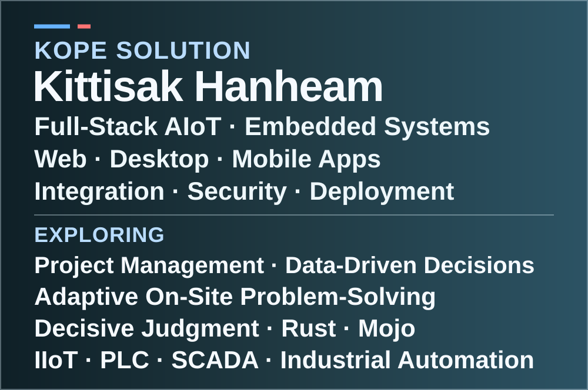
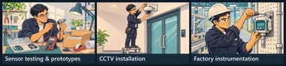

  

# Hi, I'm Kope

I work on embedded systems and IoT, from wiring sensors and writing firmware to building web, desktop, and mobile apps that help people see what their devices are doing. My background is in industrial electronics, field instrumentation, and hands-on R&D.

[KOPE SOLUTION website](https://kope-solution.github.io/knowledge-hub/) · [YouTube @KOPESOLUTION](https://www.youtube.com/@KOPESOLUTION)

## Professional experience

*Select any illustration to open it full size.*

| Years | Work |
| --- | --- |
| 2024–present | Develop AIoT systems with **data engineering and machine vision**. Build Smart Farm prototypes, firmware, and web/mobile/desktop apps. Help plan and coordinate technical work. |
| 2024 | **IoT Engineer.** ESP32, Arduino, and LoRaWAN sensor integration. Helped test tracking and live dashboards. |
| 2021–2024 | **IoT Development.** Built firmware and PCB prototypes; integrated sensors and devices in R&D and field work. Used Raspberry Pi and Jetson Nano. |
| 2019–2021 | Designed PCBs, prepared bills of materials, and tested hardware. |
| 2016–2018 | Maintained sensors and field instruments used to monitor air quality. |

## Part-time work

- **Testing and R&D:** Tested industrial instruments and sensors before shipment, developed proofs of concept, and put together hands-on learning kits.
- **Installation and integration:** Installed CCTV, helped install industrial measuring instruments in factories, and worked on access-control systems for doors, elevators, and parking facilities.

## Personal projects and research interests

- **Displays & connected platforms:** I experiment with external displays and prototype systems that connect devices, apps, and dashboards.
- **Machine Learning & Deep Learning:** I revisit model fundamentals and run small experiments to understand how data preparation and model choices affect predictions.
- **Data Engineering:** I study how to collect, clean, and organize data from connected devices, and prototype data flows for analysis.
- **Machine Vision & robotics:** I experiment with cameras and computer vision for drones, wheeled robots, and robotic arms, exploring how they can detect objects and respond. I’m also interested in surface, underwater, and humanoid robots.
- **Games, fiction, and future cities:** Researching how technology and urban systems can shape games and science-fiction stories.
- **AI and public accountability:** Exploring how AI-assisted audits could flag unusual patterns for human review and help make decisions easier to trace.
- **Knowledge sharing:** Started the KOPE SOLUTION website in 2026 to collect technical notes and experiments.

## What I do

- **Embedded & IoT:** Develop firmware for ESP32 and Arduino, integrate sensors, and connect devices using MQTT, Modbus, and LoRaWAN.
- **Web, desktop & mobile apps:** Build full-stack web apps, desktop apps, and mobile apps, including dashboards and interfaces for connected devices.
- **Integration, security & deployment:** Connect devices to the systems that use them, with attention to how they are deployed, maintained, and accessed.
- **AI-assisted development:** Use AI tools to investigate logs, compare approaches, draft tests, and write documentation. I check the output against the code or measurements before relying on it.

## Currently exploring

I’m curious about how things work and how to make them better. I take time each day to study, test ideas, and reflect on what worked and what didn’t. I share practical lessons and tutorials on [YouTube @KOPESOLUTION](https://www.youtube.com/@KOPESOLUTION).

- **Project and people management:** Planning milestones, prioritizing work, and coordinating with developers and users. Learning to set clear expectations, delegate, and give useful feedback.
- **Data-driven decisions:** Using device data and test results to decide what to fix first and check whether a change helped.
- **On-site problem-solving and decisive judgment:** Adapting when conditions change, choosing a clear next step under pressure, and documenting the handover.
- **Industrial systems:** Exploring Industrial IoT (IIoT), PLCs, SCADA, and industrial automation.
- **Programming:** Studying Rust and Mojo and exploring where each fits.

**Keen · Observe · Pioneer · Empower**\
CONTRIBUTE — Build things that are useful to others.

## GitHub activity

