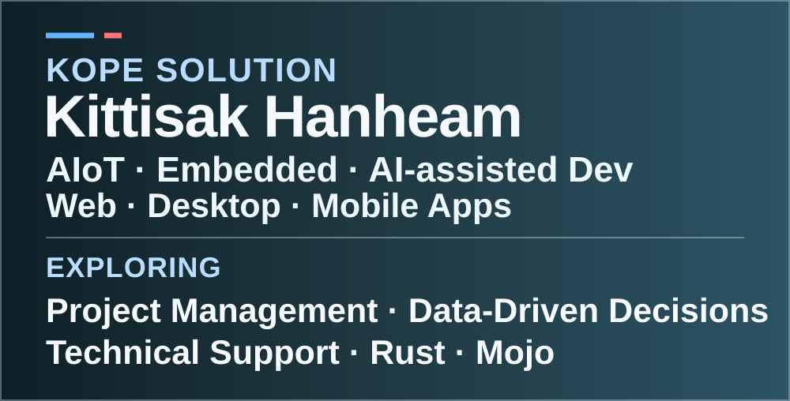
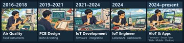

  

# Hi, I'm Kope

I work on embedded systems and IoT, from wiring sensors and writing firmware to building web, desktop, and mobile apps that help people see what their devices are doing. My background is in industrial electronics, field instrumentation, and hands-on R&D.

[KOPE SOLUTION website](https://kope-solution.github.io/knowledge-hub/) · [YouTube @KOPESOLUTION](https://www.youtube.com/@KOPESOLUTION)

## Professional experience

*Select any illustration to open it full size.*

| Years | Work |
| --- | --- |
| 2024–present | Develop AIoT systems and Smart Farm sensor prototypes, write embedded firmware, and build web, mobile, and desktop apps, including interfaces for research tools. Help plan and coordinate technical work. |
| 2024 | Integrated connected devices over LoRaWAN and helped test tracking and real-time monitoring dashboards. |
| 2021–2024 | Developed firmware and PCB prototypes and supported embedded R&D and field integration. |
| 2019–2021 | Designed PCBs, prepared bills of materials, and tested hardware. |
| 2016–2018 | Maintained sensors and field instruments used to monitor air quality. |

- **2021–2024 · IoT Development:** Integrated sensors and connected devices in R&D and field work, including work with Raspberry Pi and Jetson Nano.
- **2024 · IoT Engineer:** Worked with ESP32 and Arduino devices and integrated sensors for LoRaWAN projects.

## Part-time work

- **Testing and R&D:** Tested industrial instruments and sensors before shipment, developed proofs of concept, and put together hands-on learning kits.
- **Installation and integration:** Installed CCTV, helped install industrial measuring instruments in factories, and worked on access-control systems for doors, elevators, and parking facilities.

## Personal projects and research interests

- **Displays & connected platforms:** I experiment with external displays and prototype systems that connect devices, apps, and dashboards.
- **Computer vision & robotics:** I experiment with drones, wheeled robots, and robotic arms, exploring how cameras can help them detect objects and respond. I’m also interested in surface, underwater, and humanoid robots.
- **Games, fiction, and future cities:** Researching how technology and urban systems can shape games and science-fiction stories.
- **AI and public accountability:** Exploring how AI-assisted audits could flag unusual patterns for human review and help make decisions easier to trace.
- **Knowledge sharing:** Started the KOPE SOLUTION website in 2026 to collect technical notes and experiments. I share tutorials and playlists on YouTube.

## What I do

- **Embedded & IoT:** Develop firmware for ESP32 and Arduino, integrate sensors, and connect devices using MQTT, Modbus, and LoRaWAN.
- **Web, desktop & mobile apps:** Build full-stack web apps, desktop apps, and mobile apps, including dashboards and interfaces for connected devices.
- **Integration, security & deployment:** Connect devices to the systems that use them, with attention to how they are deployed, maintained, and accessed.
- **AI-assisted development:** Use AI tools to investigate logs, compare approaches, draft tests, and write documentation. I check the output against the code or measurements before relying on it.

## Currently exploring

- **Technical project management:** Breaking technical work into milestones, prioritizing tasks, and coordinating between developers and the people using the system.
- **People management:** Learning to set clear expectations, delegate work, give useful feedback, and support teammates' growth.
- **Data-driven decision-making:** Using device data and test results to decide what to fix first and check whether a change helped.
- **Technical support and team enablement:** Writing troubleshooting guides and handover notes so a team can maintain a system and diagnose problems without depending on one person.
- **Industrial systems and programming:** IIoT, PLC, SCADA, industrial automation, Rust, and Mojo.

**Keen · Observe · Pioneer · Empower**\
CONTRIBUTE — Build things that are useful to others.

## GitHub activity

